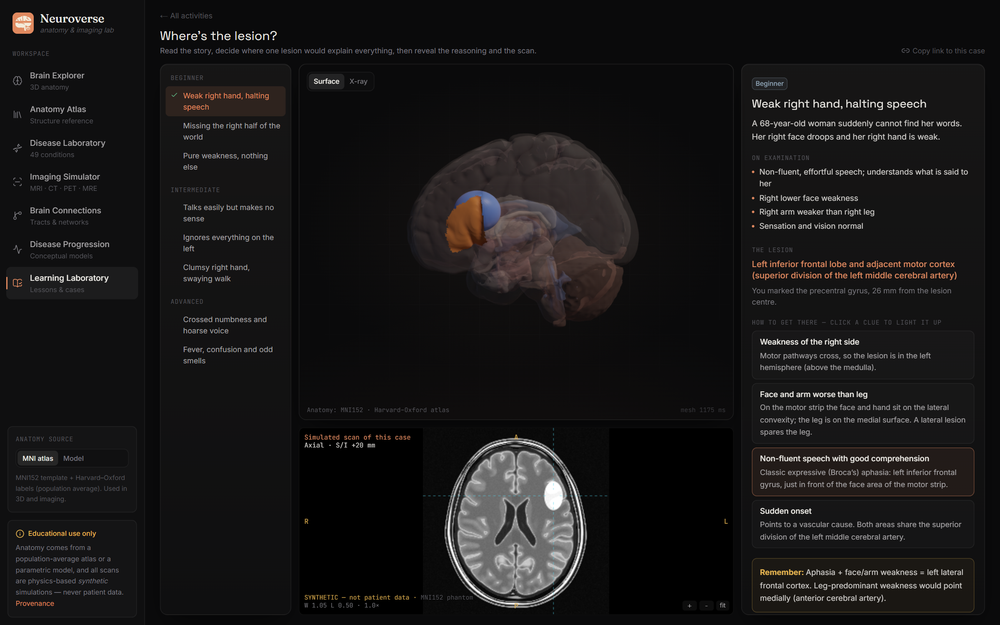

<p align="center"></p>

# Neuroverse™

An interactive 3D brain anatomy, neurological disease and medical-imaging simulation laboratory. It is an educational tool, not a diagnostic one.

**Live:** https://neuroverse-mu.vercel.app · Created by **Shakeel J**



## Using or building on Neuroverse? Please give credit

The code is open under the [MIT licence](LICENSE), which already requires you to keep the copyright notice. Beyond that, a visible credit is appreciated:

- **In an app, site or fork:** "Based on Neuroverse by Shakeel J", linking to https://github.com/ShakeelJ03/neuroverse
- **In teaching material, slides or papers:** cite it using [CITATION.cff](CITATION.cff) (GitHub's "Cite this repository" button gives the text).

The name **Neuroverse™** and the logo are not covered by the MIT licence. Forks should use their own name and logo; see [TRADEMARKS.md](TRADEMARKS.md). The atlas files in `public/atlas/` are under the FSL licence (non-commercial use); see `public/atlas/NOTICE.txt`.

## Quick start

Requires Node.js 20 or newer (tested on Node 26).

```bash
npm install
npm run dev        # http://localhost:3000
npm run build && npm start   # production
npm run typecheck
```

Anatomy has two sources, switched in the sidebar (**Anatomy source**):

- **MNI atlas** (default): surfaces and imaging phantom built from the FSL MNI152 template and Harvard–Oxford labels. The first visit downloads about 5 MB of meshes and about 5 MB of volumes, which the browser then caches.
- **Model**: the parametric signed-distance model, generated in a Web Worker (about 2–3 s in production, longer in dev mode).

The atlas assets are already built into `public/atlas/`. To rebuild them, put the TemplateFlow files listed in `public/atlas/NOTICE.txt` into `atlas-src/` and run `npx tsx scripts/build-atlas.ts` (about 10 s).

## Modules

| Route | Module | What it does |
|---|---|---|
| `/` | **Brain Explorer** | 3D brain you can rotate, pan and zoom. Click to select; the structure tree has hide/show and per-structure opacity. Also: isolate, 8 view presets (including a medial view), section planes (sagittal, coronal or axial, flippable), labels, Tissue/Atlas/X-ray render modes, auto-rotate. Deep-link with `/?s=hippocampus`. |
| `/atlas` | **Anatomy Atlas** | Reference pages for 43 structures (location, description, functions, connections, clinical significance, diseases, imaging appearance, references) with a 3D preview, in context or isolated. |
| `/diseases`, `/diseases/[id]` | **Disease Laboratory** | 49 conditions in 7 categories. Each has 11 sections, a 3D view of the affected anatomy with lesions, a healthy-vs-disease split view, an animated stage comparison, imaging deep links and references. |
| `/imaging` | **Imaging Simulator** | MRI (T1, T2, FLAIR, DWI, ADC, SWI, T1+Gd, plus a sequence lab with free TR/TE/TI/b), CT (window/level presets), PET (FDG, amyloid, tau, DOPA, FET; PET-only / PET-MRI / PET-CT fusion, opacity, PSF), and MRE (animated shear waves and elastogram, frequency control, region stiffness). Layouts: orthogonal with synchronised crosshair plus a linked 3D brain (the slice planes follow the crosshair; clicking a structure moves every scan to it), single, healthy-vs-case, and multimodal 2×2. Also has a **Real data (NIfTI)** tab using Niivue. |
| `/progression` | **Disease Progression** | Timeline slider driving the 3D model and a co-registered MRI slice. Shows illustrative biomarker curves, the biological process sequence, and a basal-ganglia circuit model for Parkinson's. |
| `/connections` | **Brain Connections** | 10 schematic white-matter bundles with DEC colour coding, a structure–function network graph, resting-state networks, an interactive diffusion tensor (FA/MD), and a primer on DTI, tractography and fMRI. |
| `/learn` | **Learning Laboratory** | Ungraded, explained lessons. **Take the brain apart**: an animated exploded view in 8 steps with captions, a spread slider and autoplay (`/learn?lesson=explode`, also linked from the Explorer toolbar). **Where’s the lesion?**: 8 clinical stories (beginner to advanced) where you mark your guess on the 3D brain, then reveal step-by-step localisation reasoning, the lesion in 3D and a simulated scan (`/learn?lesson=cases`). Plus 3 guided tours; progress is saved in the browser. |
| `/about` | **Provenance** | What is real and what is modelled, plus the dataset licensing review. |

## Architecture

```
src/
  app/                      Next.js App Router pages (one per module)
  components/
    brain/                  BrainViewer (R3F), Explorer, Atlas, StructureDetail, AnatomyProvenance
    imaging/                SliceCanvas, ModalityPane, ImagingLab, Physics, NiftiViewer, Readout, RegionStiffness
    disease/                DiseaseDetail, Progression
    connect/                Connections (tracts, network, tensor demo)
    learn/                  Learn (tours + quizzes)
    ui/                     design-system primitives (Panel, Button, Segmented, Slider, Badge, Provenance…)
  lib/
    anatomy/                noise, SDF primitives, anatomical model, lesions, Surface-Nets mesher, mesh worker + hook
    imaging/                tissue-property phantoms (parametric + atlas), slice sampler + worker pool, modality signal models, colormaps
    atlas/                  atlas label tables, volume sampling, packed-mesh format, asset loader, pathology deformation
  data/                     structures, diseases (by category), references, tracts, learning content
  store/                    zustand stores (learning progress, settings incl. anatomy source; persisted)
backend/                    FastAPI skeleton for future server-side work (not used by the web build)
scripts/build-atlas.ts      converts atlas-src/*.nii.gz into public/atlas/ (volumes, meshes, meta)
scripts/render-test.ts      renders a contact sheet of simulated slices to a PNG (npx tsx scripts/render-test.ts out.png [atlas])
public/atlas/               bundled atlas assets + NOTICE.txt (licences, citations)
```

**One coordinate frame for everything.** Both sources live in MNI millimetres with axes x = Right, y = Superior, z = Anterior, so scene (x, y, z) = MNI (x, z, y).

- *Model source:* every structure is a signed-distance field (`lib/anatomy/model.ts`). Meshes are Surface Nets iso-surfaces built in a Web Worker, and slices sample the same fields (`lib/imaging/tissue.ts`).
- *Atlas source:* `scripts/build-atlas.ts` combines the MNI152 T1, brain mask, Harvard–Oxford subcortical/cortical labels and the Buckner cerebellum mask into one segmentation, pre-builds the surfaces (the pial surface is an iso-surface of the T1 template), and stores everything in `public/atlas/`. Slices sample the same volumes (`lib/imaging/tissueAtlas.ts`), using template intensity for partial volume and labels for structure identity.
- Either way, every modality, every plane and the 3D model are co-registered by construction. That is what keeps crosshairs synchronised across modalities.

**Pathology is data.** A `Pathology` object describes a disease state: regional atrophy, ventricular scale, lesions (with kind, stage, oedema, enhancement and mass effect), tracer changes and stiffness changes. Each disease supplies `model(t)`, which maps t ∈ [0, 1] to a pathology. Mass effect is a shared spatial warp, so a tumour displaces the ventricles in 3D and in every scan identically.

On the atlas source, shape changes are approximations: atlas meshes are deformed per vertex (cortical vertices move inward by regional atrophy, structures are scaled about their centroids, the mass-effect warp is inverted by fixed-point iteration). In imaging, atrophy turns boundary voxels into CSF, and enlarged ventricles are found by shrinking the query point toward the ventricle centre. Malformations (lissencephaly, Chiari, Dandy–Walker, callosal agenesis, microcephaly) can't be expressed this way, so they switch automatically to the model source and the viewer says so.

**Extending the app.**
- Add a disease: append to a file in `src/data/diseases/`.
- Add a structure: add an SDF and mesh definition in `model.ts` (`DEEP_MESHES`), metadata in `data/structures.ts`, and tissue properties in `tissue.ts`.
- Add an MRI sequence: add an entry to `MRI_SEQS` with its timing parameters.
- Add a PET tracer: add a property channel in `tissue.ts` and an entry in `PET_TRACERS`.

## Scientific approach and data sources

| Content | Provenance class shown in the UI |
|---|---|
| 3D anatomy, atlas source | **Atlas data.** A population average (MNI152, 152 adults), so sulci are smoother than in any one brain. Each structure's panel says whether its shape is an atlas label, derived by a rule (brainstem divisions, corpus callosum, 3rd/4th ventricles, entorhinal cortex), or parametric because the atlas lacks it (hypothalamus, internal capsule, fornix, substantia nigra, pineal, pituitary). |
| 3D anatomy, model source | **Conceptual model.** A parametric reconstruction from approximate MNI coordinates. The central sulcus, lateral fissure and major sulci are explicit landmarks; tertiary gyri are procedural. |
| All simulated images | **Synthetic imaging.** Always labelled "SYNTHETIC — not patient data". |
| Disease changes and progression | **Conceptual model.** Each one states whether its stage order comes from an established imaging time course, a pathological staging scheme (e.g., Braak), longitudinal cohort data, or is purely conceptual. |
| User-loaded NIfTI | **Real imaging.** Read locally with Niivue and never uploaded. |

Physical parameters used by the simulator:
- WM/GM T1 and T2 at 3 T come from Stanisz et al. 2005.
- ADC, Hounsfield units and FDG grey/white ratios are standard literature ranges.
- Blood-product MRI and CT evolution follows Gomori et al. 1985 and standard neuroradiology texts.
- MRE stiffness values are **explicitly illustrative**, chosen within the 1–4 kPa range reported in reviews (Hiscox et al. 2016). Disease effects follow the *direction* reported in the cited studies. No diagnostic thresholds are given.

Clinical content cites guidelines and primary literature (WHO CNS 2021, McDonald 2017, NIA-AA 2018, Braak staging, AHA/ASA guidelines, ILAE reports, and others). Each reference links to a PubMed title search, so you can check the citation without trusting hard-coded identifiers. Radiopaedia links are topic searches. Before any clinical or teaching use, the content should still be reviewed by a domain expert.

### Bundled atlas data

Downloaded from TemplateFlow (MNI152NLin6Asym, 1 mm): the FSL MNI152 T1 template, brain mask, Harvard–Oxford subcortical (25 % threshold) and lateralised cortical labels, and the Buckner 2011 cerebellar parcellation (used as a mask). **Licence:** the MNI152 template and Harvard–Oxford atlases fall under the FSL licence, which is free for non-commercial use; commercial use needs a licence from Oxford University Innovation. See `public/atlas/NOTICE.txt` for files and citations. The raw downloads in `atlas-src/` are only needed to rebuild.

### Other resources evaluated (not bundled)

`/about` lists what each candidate provides and its licence:
- MNI ICBM152 2009
- Harvard–Oxford
- FreeSurfer fsaverage/aseg
- AAL3 and Brainnetome
- OpenNeuro
- IXI (CC BY-SA 3.0)
- BraTS / Medical Segmentation Decathlon
- ADNI and OASIS (data-use agreements; not redistributable)
- TCIA
- Allen Human Brain Atlas and BigBrain

## Using a different atlas

`scripts/build-atlas.ts` is the only place that knows about the source files. To use another label set (e.g., FreeSurfer aseg/aparc on fsaverage, or the 2009c template), resample it to the same 1 mm MNI grid, map its labels to the `SEG` codes and HO-style cortical regions in `src/lib/atlas/labels.ts`, and re-run the script. Mesh ids must stay the same (see `MESH_TO_STRUCTURE`) so the rest of the app keeps working.

## Known limitations

- **Atlas anatomy is a population average**, not an individual brain: it's smoother, and partial-volume blurring hides small sulci. Some shapes are rule-derived or parametric (see above). Head tissues come from template intensity: dark voxels near the brain count as CSF, others as bone, so air sinuses may show as bone, and the eyes are modelled. Disease deformation is approximate.
- **Model anatomy is not patient- or atlas-derived.** Gyral patterns beyond the named sulci are procedural. Small structures are idealised shapes (hippocampal subfields, nuclei within the thalamus, claustrum, red nucleus, subthalamic nucleus, vessels and dural sinuses are not modelled). The skull base and face are simplified.
- **The MRI simulation uses closed-form steady-state equations.** It does not simulate k-space, artefacts (except noise), B₀/B₁ inhomogeneity, flow, or magnetisation transfer. SWI uses a simplified phase mask. "Perfusion imaging" is described but not simulated.
- **CT** has no beam-hardening or streak artefacts. Coronal and sagittal planes are true sections of the phantom rather than reformats.
- **PET** uses schematic uptake maps with Gaussian PSF and noise. It does not model kinetics, attenuation or scatter. SUV units are illustrative.
- **MRE** wave propagation is a ray-based phase-accumulation approximation, not a solution of the elastic wave equation. Inversion is emulated by smoothing the true stiffness map.
- **Tracts** are hand-placed schematic streamlines, not tractography output.
- **Disease models** illustrate typical patterns. They are not fitted to data and cannot predict an individual's course.
- **Core disease entries** cover every section briefly. The comprehensive entries are Alzheimer's, Parkinson's, MS, ischaemic stroke, glioblastoma, hydrocephalus, subdural haematoma and mesial temporal sclerosis.
- **No DICOM loader.** Convert DICOM with `dcm2niix` and open the NIfTI. Cornerstone3D and VTK.js are not integrated; Niivue covers real-volume viewing.
- **Layout is designed for desktop screens of 1280 px or wider.** On narrow screens the side panels overlap the viewport.
- **Performance:** in dev mode, first-time mesh and slice generation is slower than in production.

## Licence

Code: [MIT](LICENSE) © 2026 Shakeel J. Name and logo: trademarks of Shakeel J ([TRADEMARKS.md](TRADEMARKS.md)). Atlas data: FSL licence ([public/atlas/NOTICE.txt](public/atlas/NOTICE.txt)).
